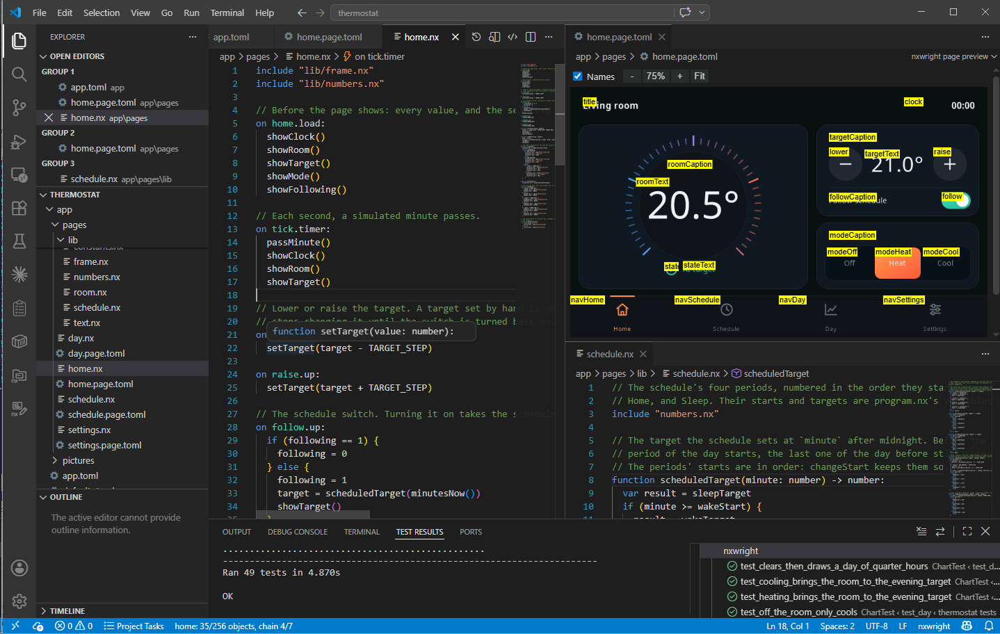
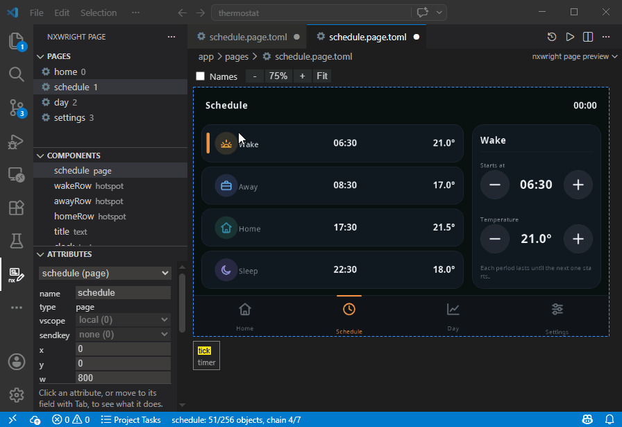
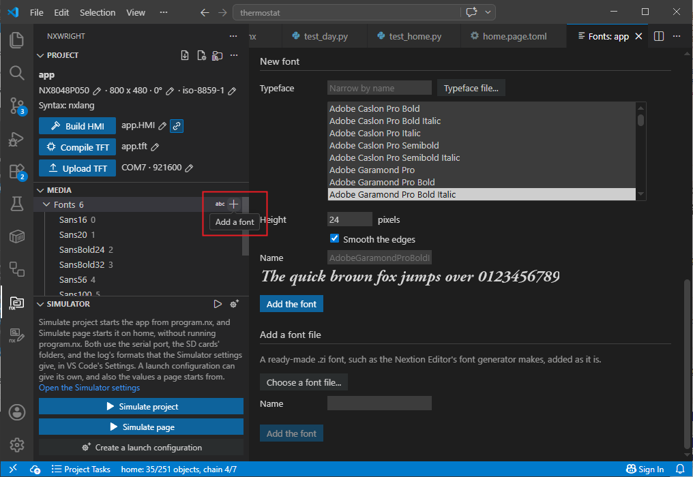
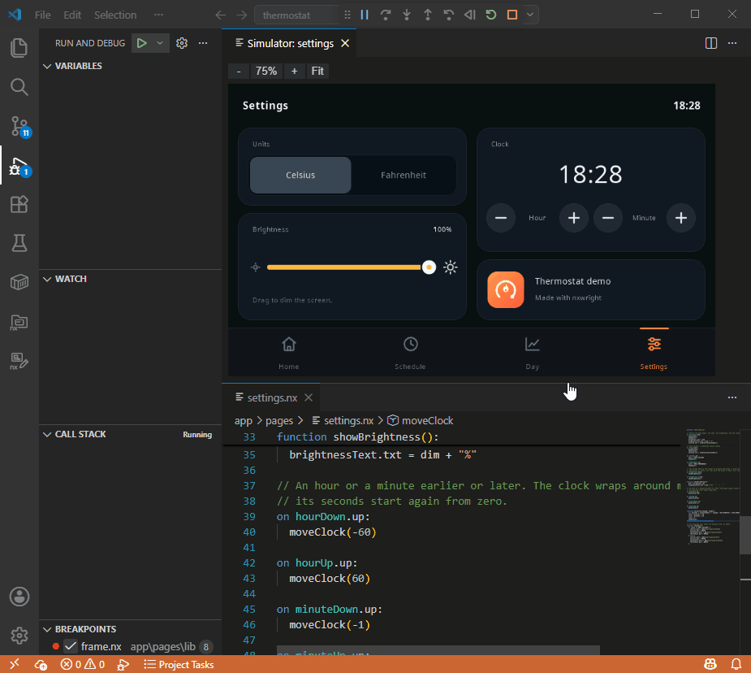
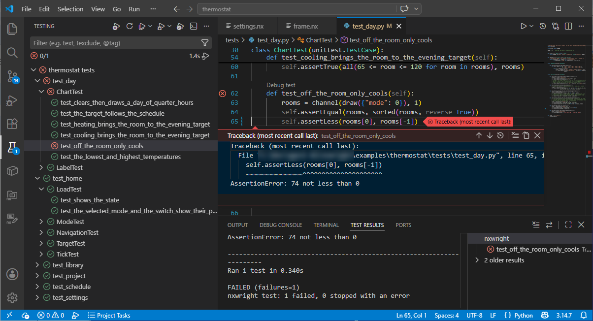

# nxwright

**Write, test, simulate, compile, and upload your Nextion HMI screen apps from plain text files: in your own editor, under version control, on Windows, Linux, or macOS.**



## TL;DR: Quick install

Needs Python 3.11 or later, and Node.js for the VS Code extension.

```
git clone https://github.com/nixiewright/nxwright
cd nxwright
pip install .
cd editors/vscode
npm install
npm run compile
```

In VS Code, run **Developer: Install Extension from Location...** and pick `editors/vscode`.

## Why nxwright

The Nextion Editor keeps your whole app in one binary `.HMI` file: you can't see what changed between two versions, merge two people's work, write automated tests or update a project with scripts or agent harnesses. The syntax is strict and limited, operator precedence is non-standard, and you are forced to edit everything in the Windows-only IDE.

nxwright turns your project into ordinary text files, and back. With it, you can:

- edit your app in the editor you like, with code that is easier to write;
- work on Windows, Linux, or macOS, including simulating and debugging your app, compiling it, and uploading it to the screen;
- keep it in Git, with readable diffs, branches, and reviews;
- test your pages and functions on your PC;
- write in nxlang, a friendlier version of the Nextion language, when you want more;
- design your screens as SVG pictures, set colors and texts with build-time defines;
- use the VS Code extension: a page preview you can edit, a font generator, a simulator, and more.

nxwright takes your app all the way to the screen: it compiles the TFT file the screen runs, and uploads it. If you prefer, you can still compile and upload in the Nextion Editor, from the project file nxwright builds ([Putting your app on a screen](https://github.com/nixiewright/nxwright/blob/main/docs/screens.md)).

## Your project as text files

`nxwright extract screen.HMI app` turns a Nextion Editor project into a source folder:

```
app/
  app.toml              the app's name, its screen and settings, and the lists of pages, pictures, and fonts
  program.nx            the code that runs when the screen starts
  pages/
    home.page.toml      the page's components and their attributes
    home.nx             the code of the page and its components
    settings.page.toml
    settings.nx
  pictures/             your pictures, as PNG, JPEG, SVG, or other picture files
  fonts/                your fonts
  animations/, videos/, sounds/
```

A component is a few readable lines, with its font and picture given by name:

```toml
[[component]]
name = "clock"
type = "text"
x = 640
y = 20
w = 136
h = 32
font = "SansBold24"
picc = "settings/normal"
pco = "#eff3f7"
txt = "00:00"
```

And a page's code is in one file, with each event under a heading:

```
on settings.load:
  brightness.val = dim

on celsius.up:
  unit = 0
```

`nxwright build app screen.HMI` turns the folder back into a project file, which you can open in the Nextion Editor to compile and upload. To skip the Nextion Editor entirely, `nxwright compile app screen.tft` compiles the folder into the TFT file the screen runs.

## Write Nextion code comfortably

The Nextion Editor is strict about how code is written: no spaces around `=` or `+`, no space after `if`, and no `{` on the `if` line. nxwright reads Nextion code written comfortably, and turns it into strict Nextion syntax when it builds the project:

<table>
<tr><th>In the Nextion Editor</th><th>In nxwright</th></tr>
<tr>
<td>

```
if(n0.val>100)
{
  n0.val=100
  t0.txt="Too high"
}else
{
  t0.txt=""
}
```

</td>
<td>

```
if (n0.val > 100) {
  n0.val = 100
  t0.txt = "Too high"
} else {
  t0.txt = ""
}
```

</td>
</tr>
</table>

You can also refer to pictures and fonts in your code by name, instead of by number: `p0.pic = @pic(icons/back)`. Your code is still in the Nextion language you know, with the same commands. To enable a lot more, see [nxlang](#nxlang).

## Use your own tooling

Because your app is now text, you can use the tools you already use for code:

- **Any editor.** nxwright's language server, `nxwright lsp`, works in VS Code, Neovim, Emacs, and any other editor that supports the Language Server Protocol. It gives you errors as you type, quick fixes, completion, descriptions on hover, go to definition, find references, rename, formatting, and hints.
- **Version control.** Every change is a diff you can read, and you can review and merge branches like any other code.
- **AI coding agents.** Agents read and write text files, and nxwright's checks and tests tell them when something is wrong. Through nxwright's MCP server, `nxwright mcp`, they can also run your app and use it: tap the screen, let time pass, and see what it shows ([docs/mcp.md](https://github.com/nixiewright/nxwright/blob/main/docs/mcp.md)).
- **The command line.** `nxwright check app` finds what would make the build fail, without building. `nxwright format app` lays your code out in one consistent style.

## Add functional and unit testing

nxwright runs your pages' code on your PC, the way the screen would, from ordinary Python tests. A test sets some values, runs events, and checks what changed. This one is from the demo, `examples/thermostat`:

```python
import unittest
from nxwright.testing import SourceFolderRunner

SCREEN = SourceFolderRunner("app")


class SettingsTest(unittest.TestCase):

    def test_the_slider_dims_the_screen(self):
        # Slide the brightness slider to 40: the screen dims, and the slider's label follows.
        values = SCREEN.run("settings", [("brightness", "slide")], {"brightness.val": 40})
        self.assertEqual(values["dim"], 40)
        self.assertEqual(values["brightnessText.txt"], "40%")
```

In nxlang, you can also test a function on its own:

```python
    def test_clamp(self):
        values = SCREEN.run_code("r.val = clamp(150, 0, 100)", {"r.val": 0}, "lib/numbers.nx")
        self.assertEqual(values["r.val"], 100)
```

Run a folder of tests with `nxwright test tests`. See [docs/testing.md](https://github.com/nixiewright/nxwright/blob/main/docs/testing.md) for everything a test can do.

## nxlang

The Nextion language is small. It has no functions, it calculates strictly from left to right, and it has no constants or local variables. As an app grows, the same code ends up copied across pages and hidden buttons.

nxlang is nxwright's version of the Nextion language. It keeps everything you know, and adds what is missing. When you build, nxlang is compiled into strict Nextion syntax, so your HMI file and the Nextion Editor work as before.

<!-- nxlang-examples: start (written by `python -m tools.readme`; edit nxwright/language/nxlang_samples.py instead) -->

### Functions

Strict Nextion has no functions. To reuse code, you usually put it in a hidden button's event, pass values through variables, and click the button. In nxlang, you write a function and call it.

<table>
<tr><th>Strict Nextion</th><th>nxlang</th></tr>
<tr>
<td>

```
// clampFn is a hidden button:
// it clamps va0 to va1, into va2.
on clampFn.down:
  if (va0.val > va1.val) {
    va2.val = va1.val
  } else {
    va2.val = va0.val
  }

on save.up:
  va0.val = value.val
  va1.val = limit.val
  click clampFn, 1
  result.val = va2.val
```

</td>
<td>

```
function clamp(value: number, limit: number) -> number:
  var result = value
  if (value > limit) {
    result = limit
  }
  return result

on save.up:
  result.val = clamp(value.val, limit.val)
```

</td>
</tr>
</table>

### Calculation order and parentheses

Strict Nextion calculates from left to right, so `a + b * 2` means `(a + b) * 2`, and it does not accept parentheses. You often need an extra line and a spare variable. nxlang calculates the way C and most languages do, multiplication first, and accepts parentheses.

<table>
<tr><th>Strict Nextion</th><th>nxlang</th></tr>
<tr>
<td>

```
on save.up:
  // total = first + (second * 2)
  sys0 = second.val * 2
  total.val = first.val + sys0
  // average = (first + second) / 2
  average.val = first.val + second.val / 2
```

</td>
<td>

```
on save.up:
  // total = first + (second * 2)
  total.val = first.val + second.val * 2
  // average = (first + second) / 2
  average.val = (first.val + second.val) / 2
```

</td>
</tr>
</table>

### Numbers in text

In strict Nextion, you convert a number to text with `covx` before adding it to a text. In nxlang, you add the number directly.

<table>
<tr><th>Strict Nextion</th><th>nxlang</th></tr>
<tr>
<td>

```
on save.up:
  covx speed.val, speedText.txt, 0, 0
  label.txt = "Speed: " + speedText.txt + " mm/s"
```

</td>
<td>

```
on save.up:
  label.txt = "Speed: " + speed.val + " mm/s"
```

</td>
</tr>
</table>

### Constants and local variables

Strict Nextion has no constants or local variables. Programs repeat literal values and use global variables to perform calculations. nxlang has named constants, which take no memory on the screen, and local variables, declared where they are needed.

<table>
<tr><th>Strict Nextion</th><th>nxlang</th></tr>
<tr>
<td>

```
on save.up:
  sys0 = first.val * 2
  if (sys0 > 1200) {
    sys0 = 1200
  }
  total.val = sys0
```

</td>
<td>

```
const LIMIT = 1200

on save.up:
  var speed = first.val * 2
  if (speed > LIMIT) {
    speed = LIMIT
  }
  total.val = speed
```

</td>
</tr>
</table>

### switch, break, and continue

Strict Nextion has no `switch`, `break`, or `continue`. You write chains of `if` and `else if`, and use flags to stop a loop early. nxlang has all three, as in C.

```
on loops.load:
  total.val = 0
  var i = 0
  while (i < 10) {
    i++
    if (i == 3) {
      continue
    }
    if (i == 8) {
      break
    }
    total.val += i
  }
  switch (total.val) {
    case 0:
      label.txt = "none"
      break
    default:
      label.txt = "some"
  }
```

### Sharing code between pages

In strict Nextion, code that several pages need is copied into each page. nxlang lets you put functions in a file and include it on any page.

```
// pages/sharing.nx
include "lib/average.nx"

on sharing.load:
  total.val = average(first.val, second.val)

// pages/lib/average.nx
// The average of two numbers, for any page including this file.
function average(a: number, b: number) -> number:
  return (a + b) / 2
```

### And more

nxlang also lets you:

- calculate inside a condition, as in `if (a.val + b.val > 10)`;
- use `!`, and mix `&&` and `||`, in a condition;
- write a minus in front of a value, as in `-speed.val`;
- test a number on its own, as in `if (flag.val)`, which is true when it is not 0;
- rely on `&&` and `||` to skip their right side when the left already decides, so `b != 0 && a / b > 1` never divides by 0;
- choose a value with `? :`, as in `t0.txt = ready.val ? "Ready" : "Waiting"`;
- write hexadecimal numbers as in C, such as `0x1` or `-0x10`;
- write `x -= a + b`, which means `x = x - (a + b)`.

<!-- nxlang-examples: end -->

### Easier to maintain

Shared code lives in one place, so a fix to a function reaches every page that includes it. A page only gets the functions it calls, so the rest of a library adds nothing to the page. Error messages give the file and the line they come from.

### Switching a project to nxlang

To switch a folder to nxlang, run `nxwright language app nxlang`, or use "Switch to nxlang" in VS Code. The switch adds parentheses to any line of your code that would calculate differently in nxlang, so that the line keeps giving the same result.

There is no command to switch back, but you can always extract the HMI file nxwright builds into a new folder of plain Nextion code.

See [docs/language.md](https://github.com/nixiewright/nxwright/blob/main/docs/language.md) for the whole language.

## The VS Code extension

The extension brings everything above into VS Code, with tools of its own:

- **Edit pages from a preview.** Each page is drawn as it will appear on the Nextion screen. Select components, drag them to move or resize them, align them, and change their attributes in the Attributes section. A double click opens a component's code.

  
- **Fonts.** Generate a font at the height you need from any typeface installed on your computer, or from a typeface file. In a utf-8 project, you can limit the font to the characters you choose. You can also open a font file to see it with a sample text, and create a variation of it.

  
- **Project management.** The nxwright side bar shows your project, and the nxwright page side bar shows the page you are working on. You can change the screen model, rotation, or encoding from the Project section of the nxwright side bar.
- **A simulator.** Run your whole app, or start it on one page. Press the screen, watch timers and pages change, connect a real serial port, compare the simulation with a real screen, and debug the code with breakpoints, stepping, and stepping back.

  
- **Tests.** Your tests appear in Test Explorer, where you can run and debug them.

  

See [editors/vscode/README.md](https://github.com/nixiewright/nxwright/blob/main/editors/vscode/README.md) for everything the extension does, and how to install it.

## Getting started

To install nxwright, follow [Quick install](#tldr-quick-install). Then `nxwright --help` lists its commands.

**Start a new project:**

```
nxwright new app                      # asks for the screen, its rotation, the encoding, the language, and the app's name
nxwright new-page app settings        # adds a blank page
nxwright build app screen.HMI         # builds the project file, to open in the Nextion Editor
```

You can rename the `app` folder whenever you like, without changing the app's name.

**Or bring in an existing one:**

```
nxwright extract screen.HMI app       # turns your project into a source folder, and names the app after the file
nxwright build app screen.HMI         # and back, after you edit it
nxwright diff app screen.HMI          # shows what differs between the folder and the project file
```

nxwright is tested with projects saved by Nextion Editor 1.68.2. A project saved by a newer version may contain things nxwright does not know, and the next build may lose some of them. `nxwright extract` warns you about each one. To tell nxwright's maintainers about these things, `nxwright report` writes a report that leaves out your project's own content ([commands.md](https://github.com/nixiewright/nxwright/blob/main/docs/commands.md#report)).

**Put it on the screen:**

```
nxwright compile app screen.tft          # compiles the TFT file the screen runs
nxwright ports                           # lists your computer's serial ports
nxwright upload screen.tft --port COM5   # sends it to the screen
```

The first compile needs the screen's firmware, which nxwright takes from your installed Nextion Editor, or downloads from Nextion's site once you agree.

**Lost a project, but still have its TFT file?** `nxwright decompile screen.tft app` gives you back a source folder, which you can build and compile again ([Recovering a project from its TFT file](https://github.com/nixiewright/nxwright/blob/main/docs/screens.md#recovering-a-project-from-its-tft-file)).

A few more commands you will use:

| Command | What it does |
| --- | --- |
| `nxwright picture app logo.png` | adds pictures |
| `nxwright font app NotoSans-Regular.ttf 20` | adds a font drawn from a typeface file |
| `nxwright keyboard app keyboard` | adds a keyboard page, for components that open one |
| `nxwright animation app frame1.png frame2.png` | makes an animation from pictures |
| `nxwright video app intro.mp4 --size 320,240` | makes a video with ffmpeg |
| `nxwright sound app beep.wav` | adds a sound |
| `nxwright device app --rotation 90` | changes the screen model, rotation, or encoding |
| `nxwright remove app font NotoSans20` | removes a page, picture, font, or media file your code no longer uses |
| `nxwright replace app picture logo new-logo.png` | puts a new file in a resource's place, keeping its ID |
| `nxwright rename app picture picture-0012 logo` | renames a page or a resource, and each use of its name |
| `nxwright rescue rescue.tft --screen NX4832T035` | writes a file for an SD card, to recover a screen that no longer responds |
| `nxwright upgrade app` | converts a folder made by an older nxwright |

`nxwright <command> --help` explains each one.

## A demo

[examples/thermostat](https://github.com/nixiewright/nxwright/tree/main/examples/thermostat) is a thermostat screen written with nxwright. It has tests, five pages in nxlang that share a library of functions, and uses both SVG and PNG for its screens. Open `thermostat.HMI` in the Nextion Editor's simulator, then read the source folder.

## Learn more

- [docs/source-folder.md](https://github.com/nixiewright/nxwright/blob/main/docs/source-folder.md): your project as a source folder, and the comfortable form of Nextion code.
- [docs/commands.md](https://github.com/nixiewright/nxwright/blob/main/docs/commands.md): every command.
- [docs/screens.md](https://github.com/nixiewright/nxwright/blob/main/docs/screens.md): compiling your app, uploading it to a screen, and recovering a project from its TFT file.
- [docs/build-rules.md](https://github.com/nixiewright/nxwright/blob/main/docs/build-rules.md): what makes the build fail.
- [docs/language.md](https://github.com/nixiewright/nxwright/blob/main/docs/language.md): nxlang.
- [docs/nxlang-compiled.md](https://github.com/nixiewright/nxwright/blob/main/docs/nxlang-compiled.md): how nxlang becomes strict Nextion syntax.
- [docs/testing.md](https://github.com/nixiewright/nxwright/blob/main/docs/testing.md): testing your app.
- [docs/simulator.md](https://github.com/nixiewright/nxwright/blob/main/docs/simulator.md): simulating your app.
- [docs/mcp.md](https://github.com/nixiewright/nxwright/blob/main/docs/mcp.md): letting an AI agent drive your app.
- [docs/screen-code.md](https://github.com/nixiewright/nxwright/blob/main/docs/screen-code.md): how tests and the simulator run Nextion code.
- [docs/format.md](https://github.com/nixiewright/nxwright/blob/main/docs/format.md): what is known of the Nextion Editor's project file.
- [docs/dumps.md](https://github.com/nixiewright/nxwright/blob/main/docs/dumps.md): writing a project file out as text with `nxwright dump`, and back with `nxwright write`.
- [ROADMAP.md](https://github.com/nixiewright/nxwright/blob/main/ROADMAP.md): what nxwright may do next.
- [CHANGELOG.md](https://github.com/nixiewright/nxwright/blob/main/CHANGELOG.md): what changed in each version.

## Contributing

See [CONTRIBUTING.md](https://github.com/nixiewright/nxwright/blob/main/CONTRIBUTING.md) for how to work on nxwright and run its tests.

## License

Apache License 2.0: see [LICENSE](https://github.com/nixiewright/nxwright/blob/main/LICENSE).

nxwright ships the Noto Sans font, by the Noto Project Authors, which is under the SIL Open Font License 1.1: see [its license](https://github.com/nixiewright/nxwright/blob/main/nxwright/project/fonts/OFL.txt).

nxwright is an independent project. It is not affiliated with, or endorsed by, ITEAD or Nextion. "Nextion" refers to the screens and the Nextion Editor that nxwright works with. See [INDEPENDENCE.md](https://github.com/nixiewright/nxwright/blob/main/INDEPENDENCE.md) for what nxwright is built on.
