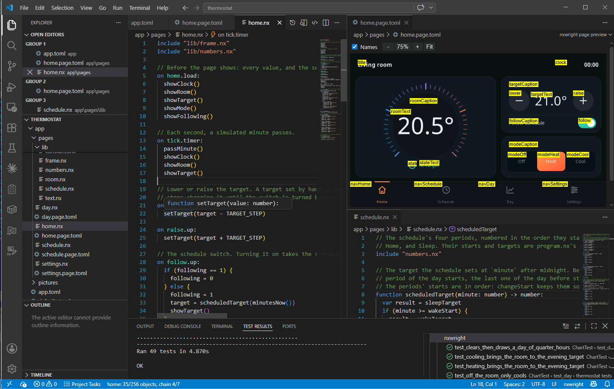
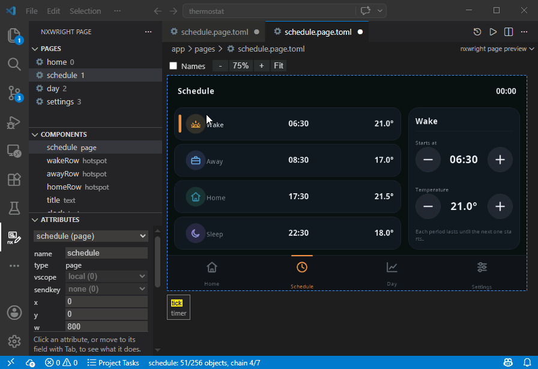
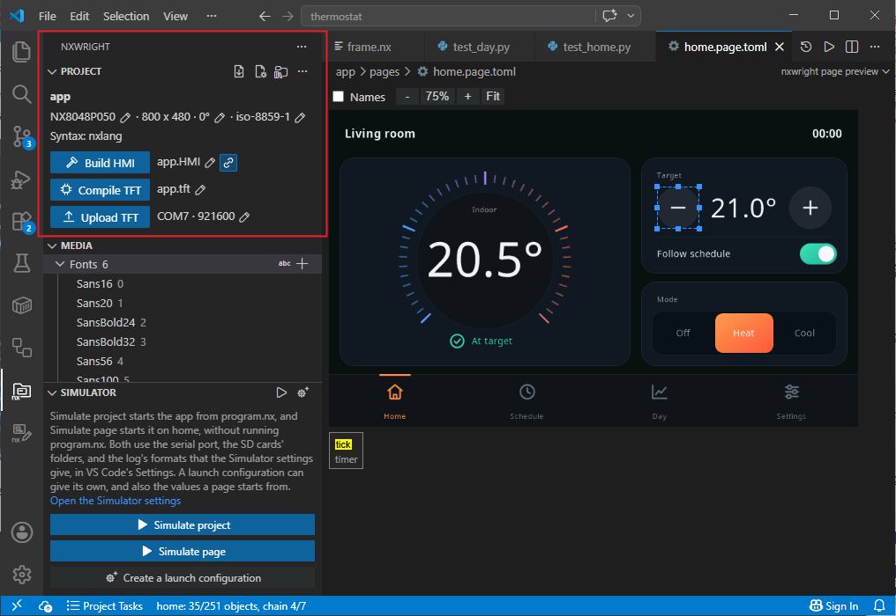
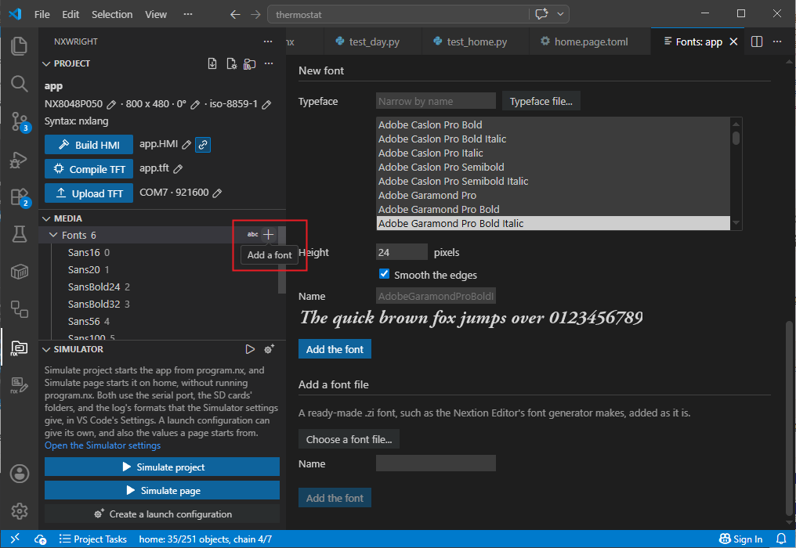
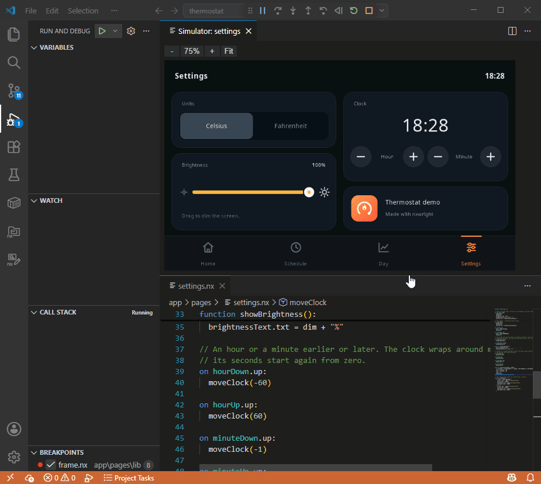
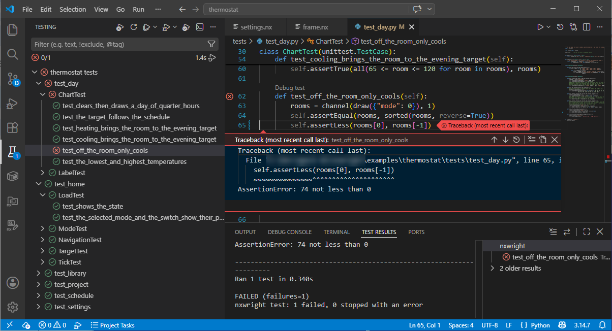

# nxwright for VS Code

**Design, write, simulate, test, compile, and upload Nextion screen apps in VS Code.** The extension brings nxwright's toolchain into VS Code: a page preview you can edit, language support with IntelliSense and code navigation, a font generator, a simulator, your tests in Test Explorer, and buttons that compile your app and upload it to the screen.



The extension works on nxwright's source folders, which keep your Nextion screen app as plain text files ([README](https://github.com/nixiewright/nxwright/blob/main/README.md)). Without nxwright installed (see [Getting started](#getting-started)), only the syntax highlighting works.

## What it does

### Edit pages visually

The page preview is a WYSIWYG editor. Open a page to display it as it will look on the Nextion screen, with your project's own fonts, pictures, and colours.
You can select, move, and resize components with the mouse or the arrow keys. Right-click to add a component, align several components, give them the same size, space them out, lock them, or group them. Spacing can make the gaps between components equal, or widen or narrow every gap by one pixel. The toolbar above the page has buttons for aligning, sizing, spacing, and bringing components forward or sending them back, so that you can repeat a command without opening the menu each time. See [The page preview's keys and mouse](#the-page-previews-keys-and-mouse) for the list of key and mouse actions.

To change an attribute, use the Attributes section of the nxwright page side bar. The bottom of the section describes what the attribute does and the valid values it can have. To change an attribute that takes its value from a define of `app.toml`, as in `bco = "%BCOLOR%"`, edit the page file instead.


Note that Nextion screens cannot show all possible colours. Colours specified either manually or with a colour picker are displayed as the nearest one on the actual screen.

When you cut, copy, paste, duplicate, or delete a component, its code goes with it.

Right-click a component and choose Paste Special to give the selected components parts of the one you copied: its size, its position, its other attributes, or its code. For example, copy a button you have styled, select three others, and paste its other attributes to give them the same colours and font. Paste Special works between components of different types.

On an empty part of the page, or on the page in the Components list, Paste Special pastes new copies, and lets you choose whether they keep their original position and their code.

Double-click a component to go to its code. If it has none yet, the extension adds its first event to the page's `.nx` file, unless the component or its page is locked. To open or add any other event, right-click the component or the page and use Go to Event. That menu also lets you rename the component, jump to its entry in the page file, or delete all its code.

You can rename a page, or lock it, by right-clicking it in the preview or in the Pages section. Renaming a page also renames its files. A locked page can't be changed from the preview or the Attributes section until you unlock it, but you can still edit its code and its page file as text. `Lock page with password` also sets a password that the Nextion Editor will ask for, which is useful if you share the project file without the source folder. VS Code doesn't ask for it. You can also delete a page from the Pages section, and leave an empty slot in its place so that the other pages keep their IDs.

Every change edits the page file, so the preview and the text editor share the same undo history. To switch between the two, use the editor picker at the top right of the editor. Its "Set Default" item lets you pick whether pages open by default in the WYSIWYG preview, or as the underlying `.page.toml` file.



### Language support

- Errors show as you type, along with warnings about likely mistakes.
- When an error has one sure fix, you can apply it as a quick fix, such as declaring `sys0` in `program.nx`, or making a component global so that a keyboard can open from it.
- Where your code or a page file refers to a picture, font, or other resource by number, as in `p0.pic=7`, the resource's name shows beside the number. A code action can write the number as the name, as in `p0.pic=@pic(logo)`, so that it still points to the resource if the resource's ID changes.
- Completion suggests attributes, components, events, functions, and constants. In page files, it also suggests your project's pictures and fonts.
- Hover over a name for its description, attributes, and allowed values, such as the numbers your code may store in an attribute.
- VS Code's usual tools work on your project: Go to Definition, Find All References, Rename, the Outline view, Go to Symbol in Workspace, and Format Document.
- Go to Definition also works on `include` paths, on `@pic(...)` and the other media references, and on a macro's name in a `call`.
- "Show this file in strict Nextion syntax" shows, next to your code, the code the Nextion Editor will receive if you build the project as an HMI file ([How nxlang becomes strict Nextion syntax](https://github.com/nixiewright/nxwright/blob/main/docs/nxlang-compiled.md)). Using an HMI file is optional: you can instead use nxwright to compile and upload directly from VS Code.


### Your project at a glance

The extension adds two side bars:

- **nxwright**, for the project: its settings, pictures, fonts, and media, the simulator, and the buttons that build, compile, and upload it.
- **nxwright page**, for the page you are working on: the list of pages, the page's components, and the attributes of the selected component.

You can change the screen model, rotation, and character encoding from the Project section of the nxwright side bar. The section also has a button for each stage on your app's way to the screen:

- **Build HMI** writes the project file (`.HMI`), which the Nextion Editor opens. If you work with nxwright alone, you need no project file.
- **Compile TFT** writes the TFT file that the screen runs. Use the link button beside the project file to choose whether Compile TFT also writes the project file, so that the two stay in step.
- **Upload TFT** compiles, then sends the TFT file to the screen over a serial port. You'll need to specify the port and upload rate if you haven't done so before. Later uploads reuse those choices, and you can change them with the pencil button in the Project section. If the project's screen model does not match the screen, the upload is aborted before sending the TFT.

A compile needs the firmware of the Nextion Editor version that nxwright supports ([The firmware](https://github.com/nixiewright/nxwright/blob/main/docs/screens.md#the-firmware)). If you don't have that version installed, nxwright can download the firmware from Nextion's site, or you can point it at a TFT file or a Nextion Editor folder of that version.

If a project file was changed outside nxwright, such as in the Nextion Editor, Build HMI and Compile TFT prompt before they replace it, and keep the old file as a backup ([Settings](#settings)).



### Fonts

The Fonts panel generates fonts from any typeface installed on your computer, or from a typeface file. In a utf-8 project, you can choose exactly which characters the font contains, to keep it small.

Open a font file to see it with a sample text, and to create a variation of it.



### Pictures, animations, videos, and sounds

The Media section lets you add pictures, and make animations, videos, and sounds from ordinary files. You can play the animations, videos, and sounds in VS Code.

Right-click a resource to replace, rename, or delete it. Replacing keeps its ID, and deleting can leave an empty slot in its place, so that numbers in your code still point to the right resources.

### Simulate your app

The simulator can be started on the whole application, like your screen would, or on a given page if you just want to run that part of your app. A panel shows the screen, and you can click its components to press them. What the app sends on its serial line appears in the Debug Console.

You can also:

- Connect the simulation to a real serial port, to talk to a program on the other end.
- Send the screen an instruction from the Simulator section, as if it came from the serial line.
- Flip the screen's GPIO inputs, in place of buttons or switches wired to them.
- Use folders on your computer as the screen's SD cards, so the app reads and writes real files.
- Set breakpoints in your code, step through it, and step back.



If you close the simulator's panel, the simulation keeps running, and the Show the screen button in the Simulator section opens the panel again.

To keep a simulation's setup, such as the page it starts on, its serial port, or its SD card folders, save it as a launch configuration. The Simulator section can create one for you (see [A simulation's launch configuration](#a-simulations-launch-configuration)).

An AI agent can drive the simulator too, through `nxwright mcp`, once you turn on `nxwright.agents.allowControl` (see [Settings](#settings)).

### Unit tests

All your tests appear in Test Explorer and can be debugged using the VS Code debugger.



### Switch to nxlang

The extension can switch a project to nxlang, nxwright's version of the Nextion language that adds powerful new functionality, and show you the lines of your code that will change as a result. Once you have switched, you can start using nxlang's extended syntax: functions, includes, local variables, standard operator precedence, and more ([nxlang](https://github.com/nixiewright/nxwright/blob/main/README.md#nxlang)).

## Getting started

You need nxwright, which needs Python 3.11 or later. See the [README](https://github.com/nixiewright/nxwright/blob/main/README.md#getting-started) for how to install it.

The extension is not published yet. To install it from a copy of nxwright's repository, see the [quick install](https://github.com/nixiewright/nxwright/blob/main/README.md#tldr-quick-install).

Then open your nxwright project's folder in VS Code. If you don't have one yet, use the nxwright side bar to create a new project, or to import one from an HMI file made in the Nextion Editor.

Optionally, install a TOML extension, such as Even Better TOML, to highlight the page files.

## Reference

### Commands

All commands are in the command palette, under "nxwright:". Most of them do what their titles say. These need more explanation:

| Command | What it does |
| --- | --- |
| Import a Nextion Editor project | Turns a `.HMI` file into a new source folder. Build HMI in the new folder then writes to that file. |
| Extract a project file into a new folder | Turns a `.HMI` file into a new source folder. Build HMI in the new folder does not write to that file. |
| Choose the project | Chooses which project the side bars show, when the workspace has several. |
| Compile a project file into a TFT file | Compiles a `.HMI` file you choose, such as one made in the Nextion Editor, into a TFT file you name. |
| Upload the TFT file to the screen | Compiles, then uploads the TFT file, the same as Upload TFT. |
| Upload a TFT file to the screen | Uploads a TFT file you choose, such as one made in the Nextion Editor, without compiling. |
| Decompile a TFT file into a new source folder | Turns a TFT file back into a source folder, to recover a project you no longer have. |
| Choose the project HMI file for the source folder | Chooses the `.HMI` file that Build HMI writes. |
| Change the screen model | Changes the screen model, and resizes every page. |
| Change the rotation | Changes the rotation, resizes every page, and rotates fonts and videos. |
| Change the character encoding | Changes the encoding, and converts the fonts. |
| Upgrade the source folder to the current format | Converts a folder made by an older version of nxwright. |
| Add a keyboard page | Adds one of nxwright's keyboard pages. For the Chinese keyboard, you also choose a font with Chinese characters. |
| Add an animation | Makes an animation from pictures, or from a GmovMaker file. |
| Add a video | Makes a video from a video file or from pictures. |
| Write pictures for the SD card | Writes picture files that the screen can show from an SD card. |
| Add a launch configuration | Adds a configuration to `launch.json` that simulates the project, with every parameter listed and commented out. |

### A simulation's launch configuration

A launch configuration of type `nxwright` simulates the source folder given by `sourceFolder`. All its other parameters are optional:

| Parameter | What it does |
| --- | --- |
| `page` | The page to start on, instead of running `program.nx`. |
| `values` | With `page`, the values to start with, such as `{"t0.txt": "Hello"}`. |
| `eeprom` | A file that keeps the EEPROM's contents between simulations. It is created if missing. Without it, the EEPROM starts empty every time. |
| `serialPort` | The serial port connected to the screen's serial line, such as `{"name": "COM4", "baud": 115200}`. |
| `gpioInputs` | The levels the GPIO inputs start at, such as `{"pio2": 0}`. Without it, every input reads 1, like a pull-up input with nothing driving it. |
| `sdCard0`, `sdCard1` | The full paths of folders on your computer to use as the screen's SD cards. Without them, each card is kept in memory. |
| `logReceived`, `logSent` | How the log shows the serial line: `text`, `hex`, or `both`. |
| `pinyinTable` | The screen's pinyin table, for Chinese input: the Nextion Editor's `input.bin`, or a TFT file. Without it, the installed Nextion Editor's table is used, if one is found. |
| `stopOnEntry` | Stops at the first line that runs. |

If a configuration leaves out a parameter that also exists in the Simulator settings, the setting's value is used (see [Settings](#settings)).

### The page preview's keys and mouse

| Action | What it does |
| --- | --- |
| Click | Selects the component under the pointer. |
| Ctrl+click | Adds a component to the selection, or removes it. |
| Drag from an empty spot | Selects every component the box overlaps, even in part. |
| Shift+drag | Draws the box wherever the drag starts, even on a component. With Ctrl too, adds what it overlaps to the selection. |
| Escape | Keeps only the first selected component. |
| Drag a selected component | Moves the selection. |
| Drag a handle | Resizes the component. |
| Arrow keys | Move the selection by 1 pixel. |
| Shift+arrow keys | Move the selection by 10 pixels. |
| Delete | Deletes the selection. |
| Ctrl+C, Ctrl+X, Ctrl+V, Ctrl+D | Copy, cut, paste, duplicate. |
| Double-click | Opens the first of the component's events that has code. If none has code, adds its first event, unless the component or its page is locked. |
| F12 | Opens the page file as text at the selected component's table, or at the page's. |
| Right-click | Opens a menu with the other actions, such as Add a component here, Align, Bring to front, Lock, and Paste Special. |
| Ctrl+mouse wheel | Zooms in or out around the pointer. |

On a Mac, use Cmd instead of Ctrl, and the delete key to delete.


### What the page preview does not show

- Values that your code sets while the page runs, because the preview shows the values in the page file. To see the page running, use the simulator.
- External pictures, and the files listed by file browsers, because they come from the SD card.
- A scrolling text's movement.
- Hotspots, because the screen does not show them either. You can still click one to select it.

### Before you edit a page

- A component's ID is its place on its page, so deleting a component, or moving it forward or backward, changes the IDs of the components after it. If your code, your attributes, or your microcontroller's code uses an ID as a number, that number will then point to a different component.
- If a component's code is in an included file, you can't delete the component from the preview, because other pages may use that code. To delete the component, first remove its events from the included file, or move them into the `.nx` files of the pages that still need them. Deleting it from the page file by hand makes the build fail, because the included file still has events for a component of that name. Clear events and Paste Special can't change code in an included file either.
- Components paste with their code only if they are the ones you copied last. Component tables from anywhere else, such as a text file, paste without code.
- Setting a component's `key` to a keyboard adds nxwright's keyboard page, if the project doesn't have it yet. The keyboard files are written right away and undo will only remove the component's key (remove the keyboard page manually if you need to).
- A keyboard only opens from a component of global scope.
- `key` 4 opens the Chinese keyboard. It only works in a gb2312 project, and you will be asked for a font with Chinese characters.
- Rename changes your code and page files, but not strings, comments, your Python tests, or a page set in a launch configuration.

### Good to know

- The status bar shows how many objects the page has (its components plus the page itself), out of the 251 allowed, and its longest chain of calls and `click` commands, out of the 7 allowed.
- Some commands, such as adding a font or changing the screen model, need your changes saved first.
- Rename, adding or pasting a component, and Format Document fail if the project would no longer build. For example, you can't rename to a name already in use, add or paste on a page that is full, or format a file with errors.
- `.nx` files are always UTF-8. VS Code saves them in UTF-8 whatever your `files.encoding` and `files.autoGuessEncoding` settings are, and the build fails on a `.nx` file that is not valid UTF-8.

## Settings

You can change these in VS Code's Settings, where they are grouped by category.

- `nxwright.command`: the command that runs nxwright, as a list of the program and its first arguments. By default, the extension looks for the `nxwright` command, or for a Python that can run nxwright, starting with the interpreter chosen in VS Code. To use a copy of nxwright's repository, you can set it to `["python", "${workspaceFolder}/nxwright/run.py"]`. If you opened a `.code-workspace` file, put this setting in that file's `settings`.
- `nxwright.backups`: keeps a backup of a project file or a TFT file that changed since nxwright wrote it, when a build or a compile replaces that file. It is on by default. Backups go beside the new file, such as `app.HMI.2026-11-06-143205.bak`, and nxwright never deletes them.
- `nxwright.lockPages`: locks the pages of a project file nxwright builds, with no password, to show in the Nextion Editor that the file is not meant for editing. It is on by default.
- `nxwright.previewGrid`: the size of the grid, in pixels, that dragged components snap to. The default is 1, which means no grid.
- `nxwright.warnWhenComponentIdsChange`: warns you when deleting, cutting, or moving components would change the IDs of components on their page. It is on by default, and choosing Don't Warn Again in the warning turns it off.
- `nxwright.testFolders`: the folders of tests that Test Explorer lists. By default, it lists every folder named `tests` next to a source folder.
- The Simulator settings, used when a launch configuration doesn't set its own value:
  - `nxwright.simulator.serialPort` and `nxwright.simulator.serialBaud`: the serial port, such as `COM4`, and its speed. Leave the port empty for none.
  - `nxwright.simulator.sdCard0` and `nxwright.simulator.sdCard1`: the full paths of the folders to use as SD cards. Leave one empty to keep that card in memory.
  - `nxwright.simulator.logReceived` and `nxwright.simulator.logSent`: how the log shows what the screen receives and sends: `text`, `hex`, or `both`. By default, what the screen receives is shown as text, and what it sends in hexadecimal.
  - `nxwright.simulator.pinyinTable`: the full path of the screen's pinyin table, for Chinese input: the Nextion Editor's `input.bin`, or a TFT file. Leave it empty to use the installed Nextion Editor's table, if one is found.
- The Agents settings, which you can set only in your user settings, never in a workspace's:
  - `nxwright.agents.allowControl`: lets an AI agent start and drive this window's simulator through `nxwright mcp`. It is off by default. Only a program that can read a file belonging to your user account can connect.
  - `nxwright.agents.startWithoutSerialPort`: makes every simulation that an agent launches start without a serial port. It is on by default. If you turn it off, the simulation uses the port from the Simulator settings, and you are asked first unless `nxwright.agents.askBeforeSerialActions` is off.
  - `nxwright.agents.askBeforeSerialActions`: asks you before an agent acts on a simulation whose serial port is connected, since what the app sends then reaches the device on that port. It is on by default. Your answer lasts until the simulation ends. If a simulation that an agent is driving has no serial port, a button in the Simulator section connects the port set in the Simulator settings. You won't be asked before the agent acts on that simulation, because connecting the port counts as your permission.

## Running nxwright from a VS Code task

A VS Code task can run any nxwright command. Errors from `nxwright check`, `nxwright build`, and `nxwright compile` show in the Problems panel with the `$nxwright` problem matcher. The errors give file paths inside the source folder, so tell the problem matcher where that folder is:

```json
{
  "version": "2.0.0",
  "tasks": [
    {
      "label": "nxwright: check",
      "type": "process",
      "command": "nxwright",
      "args": ["check", "app"],
      "problemMatcher": {
        "base": "$nxwright",
        "fileLocation": ["relative", "${workspaceFolder}/app"]
      },
      "group": "build"
    }
  ]
}
```

To compile or upload instead, change `args`:

- `["compile", "app", "app.tft", "--overwrite"]`, where `--overwrite` replaces the TFT file from the last compile. `build` takes it too, for an existing project file.
- `["upload", "app.tft", "--port", "COM5", "--yes"]`, where `--yes` skips the prompt before the file is sent.

`nxwright build` and `nxwright compile` report an error in a page file by the component's name, without a line number, so the error only shows in the terminal. `nxwright check` reports the same error with its line.
